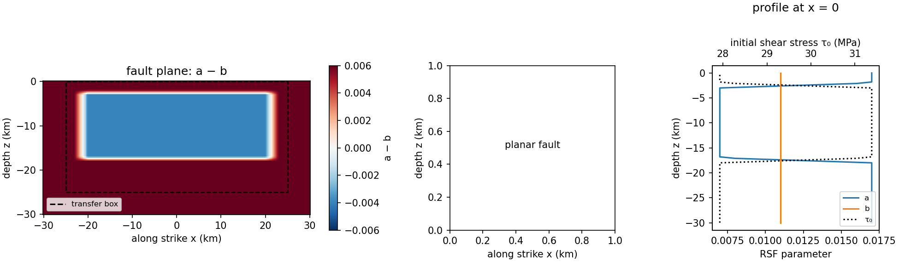

# liu2020.fdc.planar.300

Liu et al. (2020)'s ground-motion earthquake-cycle case on a planar vertical
strike-slip fault: EQquasi runs the interseismic period, EQdyna the
coseismic rupture, 300 m on-fault grid.



| | |
|---|---|
| Fault | 60 km along strike x 30 km down dip, vertical, in the xz plane |
| Roughness | none (planar) |
| Material | elastic, vp 6000 m/s, vs 3464 m/s, rho 2670 kg/m3 |
| Friction | rate-and-state, aging law; a = 0.007 in the velocity-weakening patch (\|x\| <= 20 km, \|z + 10 km\| <= 7 km), a + 0.01 outside, linear taper (3 km in x, 1 km in z); b = 0.011, Dc = 0.011 m, f0 = 0.6, v0 = 1e-6 m/s |
| Initial stress | sigma_n = -50 MPa (both native sources already agree); tau0 at steady state for the creep rate 1e-9 m/s |
| Loading | far-field 5e-10 m/s (EQquasi) |
| Cycles | `istart`-`iend` = 1-3 in `user_defined_params.py` |

Ported from EQdyna's native `case_input/liu2020.fdc.planar/user_defined_params.py`
and EQquasi's native `compset/liu2020.fdc.planar.300/user_defined_params.py`
(both at the commits pinned in `components.txt`), reconciled into this one
problem per `PROJECT_RULES.md` rule 7.

## Known input-mismatch notes

- `nt_out`: EQdyna's native file uses 20, EQquasi's native file uses 100.
  `nt_out` is a shared COMMON field (both codes must read the same value),
  so one had to be picked; this compset uses 20, following the same choice
  already made by `bp1001.fdc.rough.250`.
- `C_normal_stress_caps`: neither native source sets a caps switch for this
  planar case (old per-code rule: caps apply only to non-planar faults).
  `utils/problemDefaults.py`'s `problem` class has no default for this
  field, so an explicit value is required; this compset sets -1, the
  sentinel both codes already treat as "off" here (EQquasi: caps act only
  when the value is exactly 1; EQdyna: -1 with a planar fault, i.e.
  `insertFaultType == 0`, also means off) -- functionally identical to
  "unset," not a forced-on caps switch.

`user_defined_params.py` is the only definition. `create.newcase` converts it
into each code's `user_defined_params.py` (`utils/convert.py`).

## Run

```
source checkout.sh
create.newcase fdc runs/liu2020-planar liu2020.fdc.planar.300
cd runs/liu2020-planar && ./case.setup && ./case.submit
```

## Results

Not yet run with the pinned codes. After a run, add the slip-rate and slip
history plots here.

Regenerate the figure with `python3 utils/plot_problem.py compset/liu2020.fdc.planar.300`.
