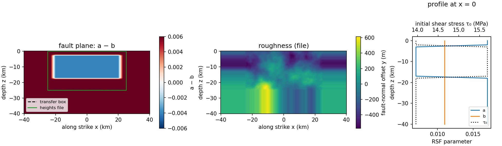

# liu2020.fdc.rough.250

Liu et al. (2020)'s ground-motion earthquake-cycle case on a rough vertical
strike-slip fault: EQquasi runs the interseismic period, EQdyna the
coseismic rupture, 250 m on-fault grid.



| | |
|---|---|
| Fault | 80 km along strike x 40 km down dip, vertical, in the xz plane |
| Roughness | heights from `rough_heights.250.txt`, converted from EQdyna's native `rough_geo_cycle.txt` (201 x 101 nodes at 250 m over x = +-25 km, z = -25...0 km), edge values repeated to the full fault grid; this is numerically the same surface already used by `bp1001.fdc.rough.250` (heights arrays compared bit-for-bit, max abs diff 0.0) |
| Material | elastic, vp 6000 m/s, vs 3464 m/s, rho 2670 kg/m3 |
| Friction | rate-and-state, aging law; a = 0.007 in the velocity-weakening patch (\|x\| <= 20 km, \|z + 10 km\| <= 7 km), a + 0.01 outside, linear taper (3 km in x, 1 km in z); b = 0.011, Dc = 0.011 m, f0 = 0.6, v0 = 1e-6 m/s |
| Initial stress | sigma_n = -25 MPa; tau0 at steady state for the creep rate 1e-9 m/s |
| Loading | far-field 5e-10 m/s (EQquasi) |
| Cycles | `istart`-`iend` = 1-1 in `user_defined_params.py` |

Ported from EQdyna's native `case_input/liu2020.fdc.rough.250/user_defined_params.py`
(+ `rough_geo_cycle.txt`) and EQquasi's native
`compset/liu2020.fdc.rough.250/user_defined_params.py` (both at the commits
pinned in `components.txt`), reconciled into this one problem per
`PROJECT_RULES.md` rule 7.

## Known input-mismatch notes

- `init_norm`: EQdyna's native file sets -50.0e6 (same mismatch pattern as
  `bp1001.fdc.rough.250`'s EQdyna native file). EQquasi's native file for
  this case already uses -25.0e6, same as it does for bp1001. Following the
  `bp1001.fdc.rough.250` precedent already established in this repo, this
  compset uses -25.0e6 as the single canonical value for both codes -- do
  not re-discover this as a surprise.
- `nt_out`: EQdyna's native file uses 20, EQquasi's native file uses 100.
  This is a shared COMMON field, so one had to be picked; this compset uses
  20, following the same choice `bp1001.fdc.rough.250` already made.
- `C_normal_stress_caps`: EQquasi's own native file for this case already
  carries an explicit `par.C_normal_stress_caps = 1` at its tail. Carried
  through explicitly onto the shared `par`, same as `bp1001.fdc.rough.250`.

`user_defined_params.py` is the only definition. `create.newcase` converts it
into each code's `user_defined_params.py` (`utils/convert.py`).

## Run

```
source checkout.sh
create.newcase fdc runs/liu2020-rough liu2020.fdc.rough.250
cd runs/liu2020-rough && ./case.setup && ./case.submit
```

## Results

Not yet run with the pinned codes. After a run, add the slip-rate and slip
history plots here.

Regenerate the figure with `python3 utils/plot_problem.py compset/liu2020.fdc.rough.250`.
