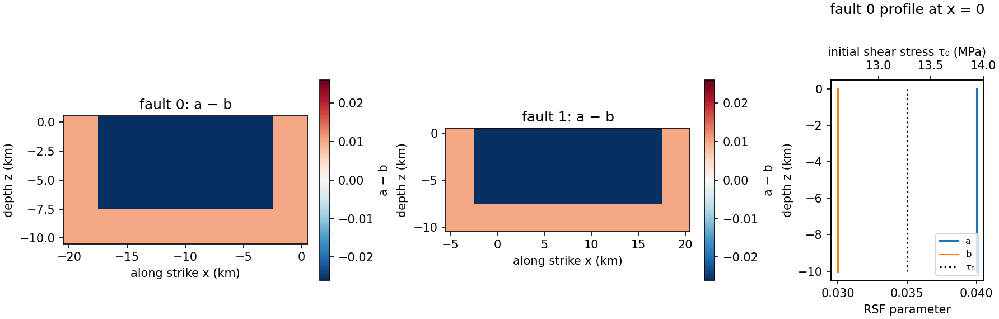

# test.stepover.2fault

A planar two-fault releasing stepover (`ntotft = 2`), 1 km grid. It is not a
benchmark: it tests the multi-fault path of `utils/convert.py` for both codes.

| | |
|---|---|
| Faults | x −20…0 km at y = 0, and x −5…20 km at y = −2 km; both z −10…0 km |
| Friction | rate-and-state, aging law; velocity-weakening for \|z\| ≤ 7 km and ≥ 3 km from each fault end |
| Initial stress | σn = −25 MPa on fault 1, −27 MPa on fault 2 |
| Mode | fully dynamic (`par.mode = 2`); `create.newcase fdc` |
| Roughness | none; EQdyna refuses a rough fault with `ntotft > 1` |

The fdc settings (`exit_slip_rate`, `xi`, `C_normal_stress_caps`, `term`,
`dt`) are those of `bp1001.fdc.rough.250`.

## Results

Run locally with the pinned codes (`--machine local`, 2026-10-11). Cycle 1
works: EQquasi reaches rupture on fault 1 after about 56 years, EQdyna runs
it to 150 s and hands back at peak slip rate 6.7e-4 m/s.

Cycle 2 used to stop within its first few steps with `STOP 508` reading
EQdyna's restart. Root cause: EQdyna hardwires its normal-stress state-law
length scale to the per-node Dc (no input for it); EQquasi's own `fric_pc_L`
defaulted to 0.0, which sets theta_pc = |sigma| instantly instead of
lagging it on EQdyna's timescale, so EQdyna's real restart state read as
inconsistent. Fixed in `utils/convert.py` (`par.fric_pc_L =
par.fric_rsf_Dc`, PR #22); upstream report on EQdyna:
https://github.com/EQDYNA/EQdyna/issues/189. Verified on a fresh fdc
rebuild (2026-10-12): cycle 2's EQquasi ran clean past 24,000+ steps / 350+
simulated years with no STOP/NaN/netCDF error.

## Handover checker

`utils/case.setup` runs `utils/check_handover.py` at every EQquasi<->EQdyna
handover of this fdc chain, before the receiving code reads the file, and
breaks the chain (nonzero exit) on any inconsistency. It currently and
**intentionally** fails every real cycle's EQquasi-to-EQdyna handover
(`fault.r.nc`), naming `vxm`/`vxs` (and `vym`/`vys`, `vzm`/`vzs`) as
antisymmetric: EQquasi writes these as relative half slip rates (vm ~= -vs),
an upstream EQquasi bug, not yet fixed (`PATHWAY_FORWARD.md` P2 row;
project-owner decision 2026-10-12 that EQdyna's absolute-particle-velocity
convention is the correct one). **This is a known-bad result the checker is
supposed to produce, not a checker bug** -- do not "fix" the checker to pass
it. The EQdyna-to-EQquasi direction (`fault.dyna.r.nc`) passes.

## Known issues

- The handover checker's EQquasi-to-EQdyna FAIL above (upstream velocity
  convention), until EQquasi is fixed upstream; see `PATHWAY_FORWARD.md`
  for open P2/P3 items.
